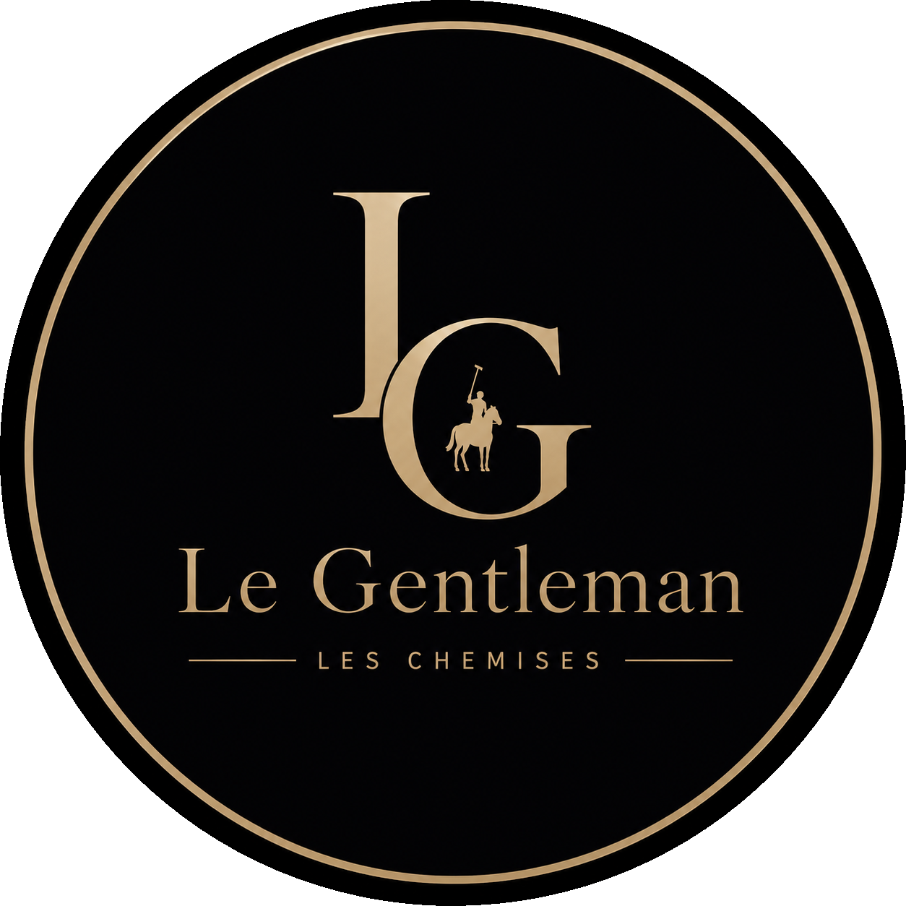

<div align="center">



# Le Gentleman — Les Chemises

**Élégance. Qualité. Distinction.**

A bilingual (**French / Arabic**) static e-commerce storefront for luxury Ralph Lauren linen shirts across **all 58 Algerian wilayas**, featuring dynamic delivery fee calculation, mobile-first design, and serverless Google Sheets order collection.


</div>

---

## Features

- **Bilingual (FR / AR) with RTL Support** — Instant language switching (`js/lang.js`) persisted in `localStorage`, automatically toggling `dir="rtl"` for Arabic.
- **58 Algerian Wilayas & Dynamic Pricing** — Real-time calculation of subtotal, wilaya delivery fee, and order total (`js/config.js` & `js/order.js`).
- **Smart Checkout Experience** — URL pre-selection (`order.html?product=white`), live product image preview, Algerian phone validation (`05` / `06` / `07`), and submission spinner.
- **Serverless Order Collection** — Direct JSON submission to a Google Apps Script Web App (`google-app-script/Code.gs`) that logs orders straight into Google Sheets.
- **Responsive & Accessible** — Mobile slide-in navigation drawer, skip-to-content link, semantic landmarks, `focus-visible` states, and custom `404.html`.
- **Direct WhatsApp Integration** — Floating WhatsApp action button and footer contact links.

---

## Tech Stack

| Layer | Technology |
|---|---|
| **Markup & Styling** | Semantic HTML5, CSS3 (Custom Properties, Grid, Flexbox, Animations) |
| **Client Logic** | Vanilla JavaScript (zero dependencies, zero build step) |
| **Typography** | Google Fonts (`Cinzel` & `Playfair Display`) |
| **Order Backend** | Google Apps Script + Google Sheets (`google-app-script/Code.gs`) |
| **Hosting** | Static hosting ready for **Netlify** (`netlify.toml` included) |

---

## Project Structure

```text
Le-Gentleman/
├── .github/
│   ├── ISSUE_TEMPLATE/
│   │   ├── bug_report.md
│   │   └── feature_request.md
│   └── PULL_REQUEST_TEMPLATE.md
├── assets/
│   ├── chemise-blanche.jpg
│   ├── chemise-bleu.jpg
│   ├── chemise-noire.jpg
│   ├── logo.jpg
│   ├── logo.png
│   └── store-background.png
├── css/
│   └── style.css               # Theme tokens, responsive layout, RTL & print styles
├── docs/
│   ├── ARCHITECTURE.md         # Module responsibilities & order sequence diagram
│   ├── CUSTOMIZATION.md        # Guide for updating prices, products, wilayas & i18n
│   └── DEPLOYMENT.md           # Netlify & Google Apps Script deployment instructions
├── google-app-script/
│   └── Code.gs                 # Google Sheets webhook handler (doPost)
├── js/
│   ├── config.js               # Centralized config: products, prices, 58 wilayas, API URL
│   ├── lang.js                 # FR/AR translations & RTL switcher
│   ├── app.js                  # Mobile hamburger menu, sticky header, scroll reveals
│   └── order.js                # Checkout state, price calculation, validation, submission
├── .editorconfig               # Consistent formatting across editors
├── .gitattributes              # Line-ending & binary handling
├── .gitignore
├── 404.html                    # Custom 404 Not Found page
├── index.html                  # Storefront landing page (Hero, Products, About)
├── LICENSE                     # MIT License
├── netlify.toml                # Netlify build, security headers & cache control
├── order.html                  # Checkout & order form
├── README.md
├── robots.txt
└── success.html                # Order confirmation page
```

---

## Local Development

No package installation or build step is required. Serve the root directory with any static HTTP server:

```bash
# Using Node.js (npx)
npx serve -l 8080

# Or using Python
python -m http.server 8080
```

Then open **http://localhost:8080** in your browser.

---

## Documentation

- **[Architecture Guide](docs/ARCHITECTURE.md)** — File layout, script load order, and end-to-end order sequence diagram.
- **[Customization Guide](docs/CUSTOMIZATION.md)** — Updating shirt prices, adding products, editing the 58 wilaya delivery fees, translations, and theme colors.
- **[Deployment Guide](docs/DEPLOYMENT.md)** — Deploying to Netlify from GitHub and configuring Google Apps Script + Google Sheets.

---

## Contact

- **Founder:** Tarek Zerari
- **Phone / WhatsApp:** `+213 561 069 167` ([Chat on WhatsApp](https://wa.me/213561069167))
- **Repository:** [tarekzerari-dev/Le-Gentleman](https://github.com/tarekzerari-dev/Le-Gentleman)

---

## License

This project is licensed under the [MIT License](LICENSE).
