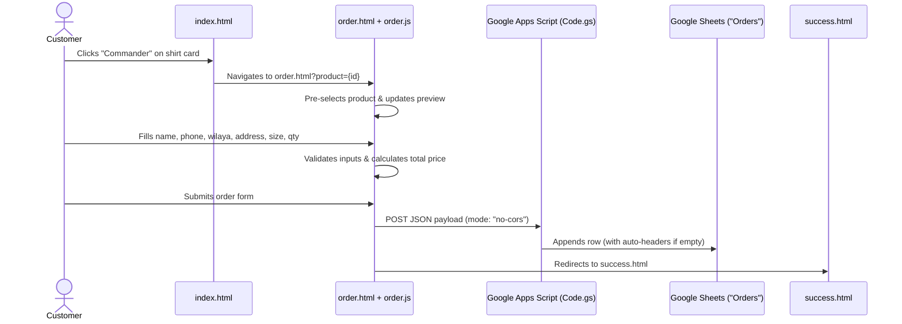

# Architecture Guide

Le Gentleman is a static, zero-build web storefront built with semantic HTML5, modern CSS3, and modular vanilla JavaScript.

## Repository Layout

```text
Le-Gentleman/
├── .github/                  # GitHub Issue & PR templates
├── assets/                   # Brand logos, store background, product photography
├── css/
│   └── style.css             # Complete theme, responsive breakpoints, RTL, print styles
├── docs/                     # Project documentation
├── google-app-script/
│   └── Code.gs               # Google Sheets webhook handler (doPost)
├── js/
│   ├── config.js             # Central store configuration (products, prices, 58 wilayas)
│   ├── lang.js               # Bilingual i18n dictionary & LTR/RTL switcher (FR / AR)
│   ├── app.js                # Shared UI interactions (mobile drawer, scroll reveal, nav state)
│   └── order.js              # Checkout form population, validation, pricing, submission
├── index.html                # Landing page (Hero, Catalog, About)
├── order.html                # Checkout page with live product preview & order summary
├── success.html              # Order confirmation page
├── 404.html                  # Custom Not Found page
├── netlify.toml              # Netlify publish directory, security & cache headers
└── robots.txt                # Search engine crawling directives
```

## Script Load Order

Pages load JavaScript in a deterministic order using standard `<script>` tags so globals (`CONFIG`, `translations`, `t`, `getLang`) are available across modules without requiring a bundler:

1. `js/config.js` — Defines `CONFIG` (`siteName`, `shirtPrice`, `currency`, `whatsappNumber`, `scriptURL`, `products`, `sizes`, `wilayas`).
2. `js/lang.js` — Defines `translations` (`fr`, `ar`) and helper functions (`setLang`, `getLang`, `t`, `applyTranslations`, `updateLangButtons`).
3. `js/app.js` — Initializes the mobile hamburger menu, sticky header scroll state, scroll-reveal observer, and active nav links.
4. `js/order.js` *(only on `order.html`)* — Populates `<select>` dropdowns from `CONFIG`, reads `?product=` URL parameters, calculates dynamic delivery totals, validates inputs, and posts orders to `CONFIG.scriptURL`.

## Order Submission Flow



> **Note on `no-cors`:** Google Apps Script Web Apps do not return standard CORS headers on `POST` redirects from browsers. `order.js` uses `mode: "no-cors"`, meaning network-level failures trigger the `catch` handler while successful opaque requests proceed to `success.html`.
